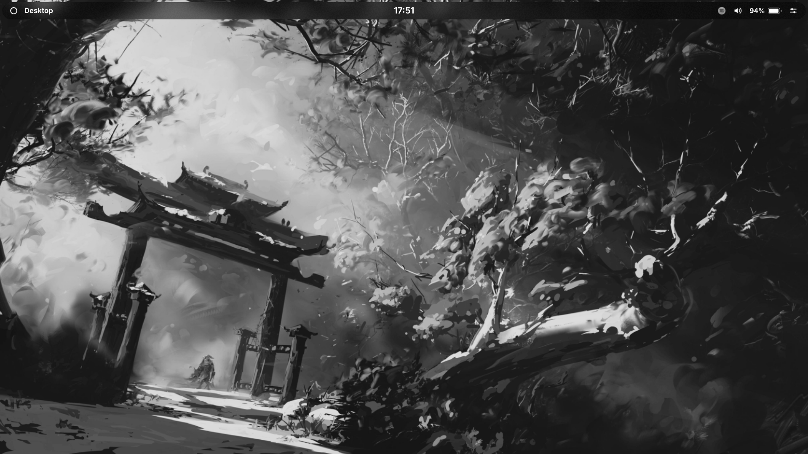
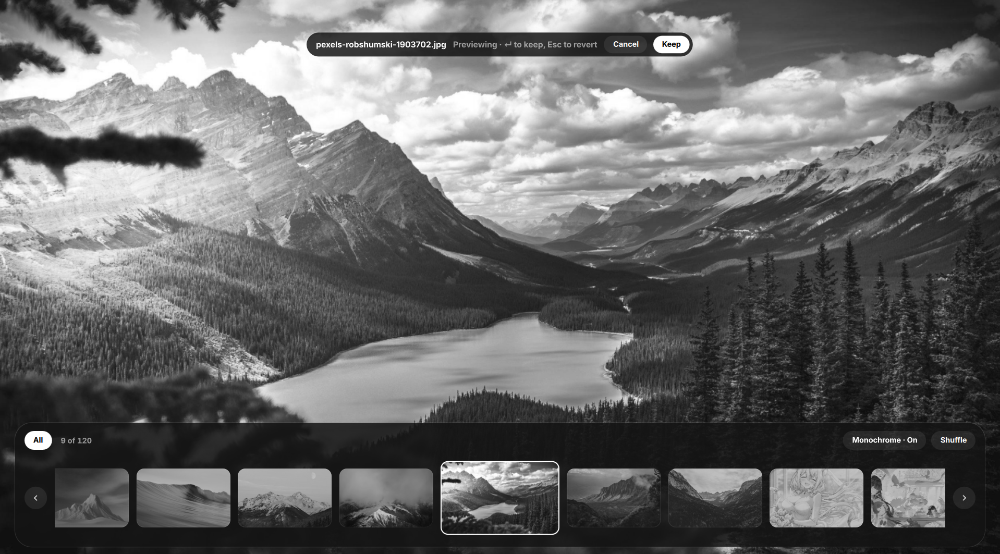
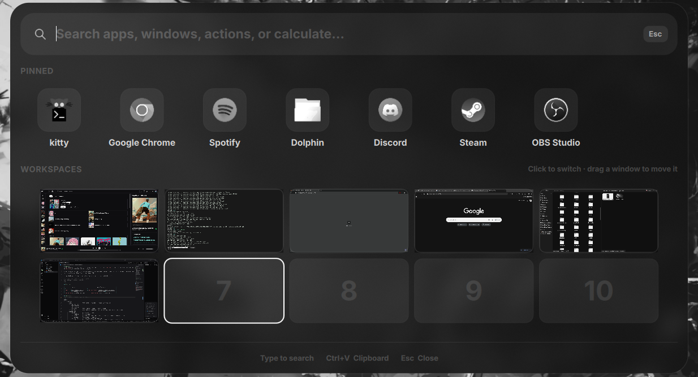
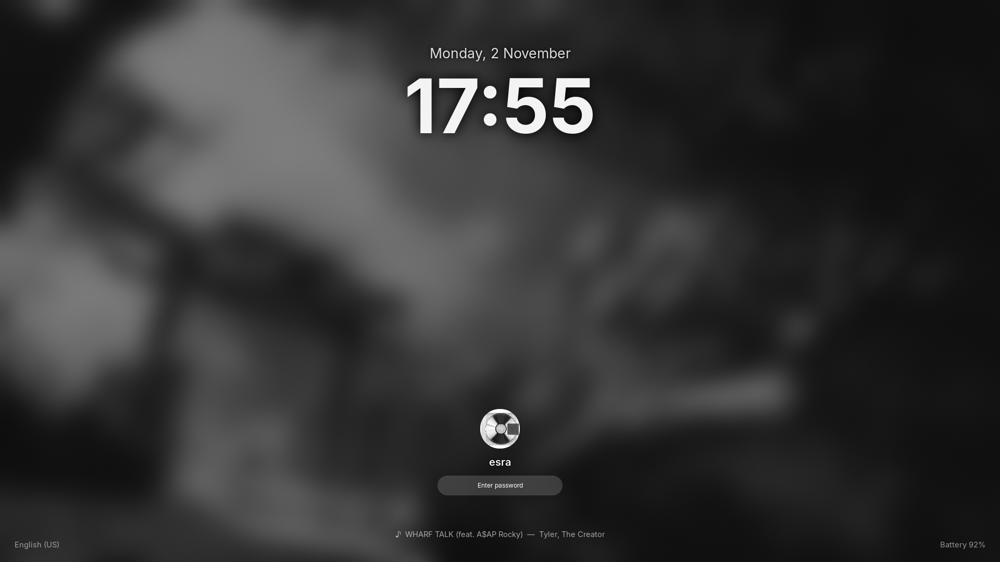

# macmono

My personal dotfiles: a **macOS-style monochrome shell** built with [Quickshell](https://quickshell.org) on top of [Hyprland](https://hyprland.org) (Wayland).

Every color in this shell is pure gray (R=G=B), with no accent colors at all. The look is minimal and clean, and everything is controlled from a single theme file.

> Used daily on **CachyOS**. Tested on **Hyprland 0.57** and **Quickshell 0.3.2**.

## Preview

|              Desktop              |           Wallpaper Selector            |
| :-------------------------------: | :-------------------------------------: |
|    |  |
|           **Launcher**            |             **Lock Screen**             |
|  |         |

## Repo layout

```
macmono/
└── config/
    ├── hypr/
    │   ├── hyprland.lua
    │   ├── hyprland-gui.lua
    │   ├── hypridle.conf
    │   ├── hyprland/       # base config, library, and scripts
    │   └── custom/         # personal overrides
    └── macmono/
        ├── shell.qml       # Quickshell entry point
        ├── core/           # settings, system facade, shortcuts, and theme
        ├── features/       # launcher, control center, lock screen, and other UI
        ├── shared/         # reusable components, services, and assets
        ├── scripts/        # audio, capture, development, and session utilities
        └── docs/           # audits and changelogs
```

The installer maps `config/hypr/` to `~/.config/hypr/` and `config/macmono/` to
`~/.config/quickshell/macmono/`.

## Features

- **Menu bar** in macOS style, with a full system tray
- **Launcher** (tap `Super`) and workspace **overview**
- **Control Center**: WiFi, Bluetooth, battery, media controls, power actions, and a tools panel
- **Notifications** and **OSD** (volume / brightness)
- **Clipboard manager** powered by `cliphist`
- **Emoji picker** with search and clipboard copy
- **Area screenshot** and **screen recording** (`wf-recorder`)
- **Calendar**, **media popup**, keybind **cheatsheet**, and **power menu**
- **Lock screen** (`hyprlock`) plus idle auto-lock (`hypridle`)
- **Centralized theme**: all colors, radii, and font sizes live in `config/macmono/core/theme/Theme.qml`

## Base config

macmono runs on top of the [end-4 / dots-hyprland](https://github.com/end-4/dots-hyprland) config. Shortcut names and keybinds are intentionally kept identical, so `Super`, `Super+N`, `Super+L`, `Ctrl+Super+T`, `Super+Shift+S`, idle auto-lock, and the rest plug straight into macmono.

## Dependencies

Required:

- `hyprland`, `hyprlock`, `hypridle`
- `quickshell`
- `pipewire` (audio), `networkmanager` (`nmcli`), `bluez` (Bluetooth), `upower` (battery)
- `brightnessctl`, `libnotify` (`notify-send`), `jq` (JSON parsing), `cava` (media visualizer)
- `playerctl` (media controls and lock-screen metadata), `bc` (media keybind)
- A polkit agent (any one): `polkit-kde-agent`, `hyprpolkitagent`, or `polkit-gnome`

For specific features:

- `grim`, `slurp`, `imagemagick` (`magick`), `wl-clipboard` (`wl-copy`): screenshots and region selection
- `cliphist`: clipboard manager
- `wf-recorder`: screen recording (GPU encoding via VA-API when available)
- `systemsettings`, `gnome-control-center`, or `better-control`: settings app (`Super+I`)

Install on Arch / CachyOS:

```bash
sudo pacman -S hyprland hyprlock hypridle quickshell \
  networkmanager bluez bluez-utils upower brightnessctl libnotify \
  jq cava playerctl bc grim slurp imagemagick wl-clipboard cliphist wf-recorder
```

## Installation

### Quick install (script)

```bash
git clone https://github.com/esrahmn/macmono-shell.git
cd macmono-shell
./install.sh
```

The script installs the dependencies with `pacman` (Arch / CachyOS), backs up
`~/.config/hypr` and `~/.config/quickshell/macmono` as
`*.bak-<timestamp>`, then copies the configs in. Other Quickshell configs are
left untouched.

| Option            | Description                                                 |
| ----------------- | ----------------------------------------------------------- |
| `-l`, `--link`    | Symlink instead of copying, so edits in the repo apply live |
| `-n`, `--no-deps` | Skip installing packages                                    |
| `-y`, `--yes`     | Non-interactive, no confirmation prompts                    |
| `-h`, `--help`    | Show help                                                   |

You can also run it without cloning first (it clones the repo into `~/.local/share/macmono-shell`):

```bash
bash <(curl -fsSL https://raw.githubusercontent.com/esrahmn/macmono-shell/main/install.sh)
```

### Arch package (`macmono-git`)

Prefer a real pacman package? Build it straight from this repo:

```bash
git clone https://github.com/esrahmn/macmono-shell.git
cd macmono-shell/packaging/arch
makepkg -si
```

The shell is installed to `/etc/xdg/quickshell/macmono`, so `qs -c macmono` works
without touching your home directory. A copy in `~/.config/quickshell/macmono`
takes priority if you want to override it. The package only ships the shell:
get the Hyprland config from `macmono/config/hypr` (or run `./install.sh`).

### Manual install

Prefer to do it by hand? **Back up your existing config first.**

```bash
git clone https://github.com/esrahmn/macmono-shell.git
cd macmono-shell

# back up existing configs (if present)
[ ! -e ~/.config/hypr ] || mv ~/.config/hypr ~/.config/hypr.bak
[ ! -e ~/.config/quickshell/macmono ] || mv ~/.config/quickshell/macmono ~/.config/quickshell/macmono.bak

# install
mkdir -p ~/.config/hypr ~/.config/quickshell
cp -r macmono/config/hypr/. ~/.config/hypr/
cp -r macmono/config/macmono ~/.config/quickshell/macmono
```

Then log back into Hyprland, or launch the shell directly:

```bash
qs -c macmono
```

> If you don't have end-4's config yet, `macmono/config/hypr/hyprland/` in this
> repo already ships the base config. If you already use end-4's dots, copy
> `macmono/config/hypr/custom/` and `macmono/config/macmono/`.

## Key bindings

| Keybind               | Action                |
| --------------------- | --------------------- |
| `Super` (tap)         | Toggle launcher       |
| `Super + Tab`         | Workspace overview    |
| `Super + V`           | Clipboard manager     |
| `Super + .`           | Emoji picker          |
| `Super + N`           | Toggle control center |
| `Super + M`           | Media controls        |
| `Super + /`           | Keybind cheatsheet    |
| `Super + J`           | Toggle/disable bar    |
| `Super + L`           | Lock screen           |
| `Super + Shift + S`   | Area screenshot       |
| `Ctrl + Super + T`    | Wallpaper picker      |
| `Ctrl + Super + R`    | Reload shell          |
| `Ctrl + Alt + Delete` | Session / power menu  |

The full list is in `macmono/config/hypr/hyprland/keybinds.lua`. Put personal
keybinds in `macmono/config/hypr/custom/keybinds.lua`.

## Customization

- **Appearance**: edit `macmono/config/macmono/core/theme/Theme.qml`, then reload with `Ctrl + Super + R`. Other QML files should use `Theme.<name>` rather than hardcoding colors or sizes.
- **Keybinds**: `macmono/config/hypr/custom/keybinds.lua`
- **Autostart**: `macmono/config/hypr/custom/execs.lua`
- **Window rules**: `macmono/config/hypr/custom/rules.lua`
- **Variables**: `macmono/config/hypr/custom/variables.lua`

## Credits

macmono wouldn't exist without the work of these people and projects. Huge thanks to all of them.

**Core**

- [Quickshell](https://quickshell.org) by [@outfoxxed](https://github.com/outfoxxed): the toolkit that powers the whole shell
- [Hyprland](https://github.com/hyprwm/Hyprland) by [@vaxerski](https://github.com/vaxerski) (Vaxry) and the [hyprwm](https://github.com/hyprwm) contributors: the compositor
- [hyprlock](https://github.com/hyprwm/hyprlock) and [hypridle](https://github.com/hyprwm/hypridle) by [@vaxerski](https://github.com/vaxerski) and the hyprwm contributors: lock screen and idle daemon
- [end-4 / dots-hyprland](https://github.com/end-4/dots-hyprland) by [@end-4](https://github.com/end-4): the base config, keybind layout, and a big source of inspiration

**Tools and services used**

- [cliphist](https://github.com/sentriz/cliphist) by [@sentriz](https://github.com/sentriz): clipboard history
- [grim](https://gitlab.freedesktop.org/emersion/grim) by [@emersion](https://github.com/emersion) (Simon Ser): screenshots
- [wf-recorder](https://github.com/ammen99/wf-recorder) by [@ammen99](https://github.com/ammen99): screen recording
- [wl-clipboard](https://github.com/bugaevc/wl-clipboard) by [@bugaevc](https://github.com/bugaevc): Wayland clipboard utilities
- [brightnessctl](https://github.com/Hummer12007/brightnessctl) by [@Hummer12007](https://github.com/Hummer12007): brightness control
- [ImageMagick](https://imagemagick.org): image processing for screenshots and thumbnails
- [PipeWire](https://pipewire.org), [NetworkManager](https://networkmanager.dev), [BlueZ](https://www.bluez.org), and [UPower](https://upower.freedesktop.org): audio, network, Bluetooth, and battery services
**Design inspiration**

- macOS, for the menu bar, Control Center, and overall look and feel

## License

[GPL-3.0](LICENSE)
